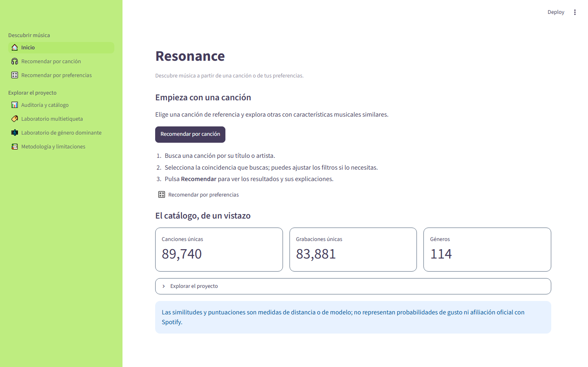

# Resonance — Inteligencia y recomendación musical

**Descubre música a partir de una canción o de tus preferencias.**

Resonance es un proyecto personal de ciencia de datos y machine learning para
explorar un catálogo musical mediante recomendaciones basadas en contenido.
Su aplicación web permite partir de una canción conocida o de un perfil musical
editable, comparar resultados y consultar sus características. Los laboratorios
de clasificación de géneros complementan el producto como experimentos.

**Aplicación en Streamlit:** [https://music-intelligence-lab.streamlit.app/](https://music-intelligence-lab.streamlit.app/)

[Cómo usarla](#primera-recomendación) ·
[Ejecutar en local](#ejecución-local) ·
[Resultados y limitaciones](#resultados-y-limitaciones)

**Tecnologías:** Python · Streamlit · Pandas · NumPy · scikit-learn · Plotly.

## Vista previa



*Captura de la ejecución local con la interfaz actualizada. La demo publicada
puede diferir hasta el próximo despliegue.*

## Qué puedes hacer

| Recorrido | Qué ofrece |
|---|---|
| **Por canción** | Búsqueda por canción o artista, filtros y comparación de características con la canción de referencia. |
| **Por preferencias** | Perfiles iniciales editables, importancia por característica y diversidad opcional. |
| **Explorar el proyecto** | Auditoría del catálogo, laboratorios de géneros y metodología con sus limitaciones. |

Ambos recomendadores muestran sus resultados en tablas y permiten descargarlos
en CSV, sin entrenar modelos durante la interacción.

### Primera recomendación

1. Abre la demo y pulsa **Recomendar por canción**.
2. Busca una canción o artista y selecciona la coincidencia que quieres usar.
3. Pulsa **Recomendar** y abre las características comparadas de cada resultado.

## Resultados y limitaciones

- La [evaluación del recomendador](reports/metrics/track_recommender_evaluation.json)
  registra autorrecomendaciones, duplicados, cumplimiento de filtros, cobertura
  y latencia. Es una evaluación técnica, no una medición de satisfacción.
- La [comparación de variantes](reports/experiments/recommender_relevance_analysis.json)
  permite examinar el equilibrio entre coherencia de género, similitud y diversidad.
  Priorizar un criterio no implica mejorar todos los demás.
- **Similitud no significa probabilidad de gusto.** Las sugerencias dependen
  del catálogo y sus características, no garantizan una preferencia personal.
- Los clasificadores de géneros son experimentales. Sus resultados sobre test
  están en los reportes [multietiqueta](reports/metrics/multilabel_final_test_evaluation.json)
  y [multiclase](reports/metrics/multiclass_final_test_evaluation.json); no deben
  interpretarse como predicciones infalibles ni como probabilidades calibradas.

## Aplicación publicada

Puedes abrir la versión publicada desde el navegador, sin instalar Python:

**[https://music-intelligence-lab.streamlit.app/](https://music-intelligence-lab.streamlit.app/)**

Los comandos de la siguiente sección son únicamente para ejecutar el proyecto en tu equipo.

## Ejecución local

Requiere Python 3.12.x y [uv](https://docs.astral.sh/uv/).
Desde la raíz del repositorio:

```powershell
uv sync
uv run streamlit run streamlit_app.py
```

La aplicación utiliza los artefactos ya construidos. Si falta alguno, muestra
un error claro; no lo entrena silenciosamente.

| Página | Artefacto necesario | Script de construcción |
|---|---|---|
| Recomendar por canción | `models/recommender/v1/` | `scripts/build_recommender.py` |
| Recomendar por preferencias | `models/preferences/v1/` | `scripts/build_preference_recommender.py` |
| Laboratorio multietiqueta | `models/classifier/multilabel/` | `scripts/train_multilabel_classifier.py` |
| Laboratorio de género dominante | `models/classifier/multiclass/` | `scripts/train_multiclass_classifier.py` |

## Documentación

- [Arquitectura](docs/architecture.md): organización del código y sus responsabilidades.
- [Recomendadores](docs/spec/recommenders.md): métodos y reglas de recomendación.
- [Aplicación](docs/spec/application.md): páginas, navegación y presentación de resultados.
- [Despliegue](docs/deployment.md): ejecución publicada y requisitos de artefactos.

## Fuente del dataset

Catálogo musical *Spotify Tracks Dataset* (≈ 114.000 filas) descargado de Kaggle:

[Spotify Tracks Dataset](https://www.kaggle.com/datasets/maharshipandya/-spotify-tracks-dataset/data)

Resonance es un proyecto independiente, sin afiliación oficial con Spotify.

## Detalle técnico

<details>
<summary>Pipeline y módulos implementados</summary>

## Funcionalidad implementada

### Módulo 1 · Ingesta, auditoría y validación
- Auditoría reproducible del catálogo: validación de columnas, tipos, rangos y anomalías del dataset.
- Reporte de calidad en `reports/data_quality/data_quality_report.json` con hash SHA-256 del archivo bruto.
- Notebook `notebooks/01_data_audit.ipynb`.

### Módulo 2 · Limpieza, catálogo e identidad
- Pipeline reproducible `scripts/prepare_data.py` con manifiesto en `data/processed/prepare_data_manifest.json`.
- Cuarentena de identidad inválida en `data/quarantine/`.
- Catálogo consolidado por `track_id` (`tracks.parquet`) con popularidad min/max/mediana.
- Tablas puente de géneros, artistas y grabaciones (`track_genres`, `track_artists`, `recording_tracks`, `recording_genres`, `genre_catalog`).
- `recording_group_id` exacto (huella normalizada + SHA-256) con 83.881 grupos verificados.
- Catálogo canónico por grabación (`recordings.parquet`) con track representativo.
- Reporte de candidatos a casi duplicados sin fusión automática (`reports/identity/near_duplicate_candidates.csv`).
- Notebook `notebooks/02_identity_analysis.ipynb`.

### Módulo 3 · Análisis exploratorio
- Distribuciones, anomalías y duraciones extremas.
- Correlaciones y redundancia de características.
- Solapamiento y co-ocurrencia de géneros.
- Figuras exportadas a `reports/figures/`.
- Notebook `notebooks/03_exploratory_analysis.ipynb`.

### Módulo 4 · Recomendador por canción
- Servicio no supervisado basado en `recording_group_id` con features acústicas (R1 aprobado: StandardScaler + coseno + brute).
- Artefactos versionados en `models/recommender/v1/` (`scaler.joblib`, `neighbors.joblib`, `catalog_matrix.npy`, `catalog_index.parquet`, `manifest.json`).
- Flujo online con recuperación progresiva, exclusión de la propia grabación, deduplicación de grupos y orden estable.
- Filtros desactivados por defecto (explícito, género, duración, artista, popularidad mínima).
- Explicaciones por característica y diferencia de tempo en BPM.
- Evaluación offline en `reports/metrics/track_recommender_evaluation.json/.csv` (muestra de 200 semillas: 0 autorrecomendaciones, 0 duplicados, 100 % cumplimiento de filtros).
- Variante experimental de **afinidad de género** como control desactivado por defecto en las opciones avanzadas; prioriza canciones del mismo género de la referencia dentro del grupo de candidatos acústicos recuperados, sin añadir candidatos fuera de él.
- Análisis de relevancia (`scripts/analyze_recommender_relevance.py`, 2000 semillas) en `reports/experiments/recommender_relevance_analysis.json` — evaluado con las métricas oficiales:

  | Variante | Coherencia@10 media | Coseno medio | Diversidad interna (std) | Artistas únicos por lista |
  |---|---|---:|---:|---:|
  | Baseline | 0,131 | 0,9705 | 0,0065 | 0,948 |
  | Pesos ajustados | 0,131 | 0,9607 | 0,0140 | 0,950 |
  | Afinidad de género | **0,552** | 0,9605 | 0,0131 | 0,906 |

  La afinidad cuadruplica la coherencia de género con −0,01 de similitud, casi sin perder variedad de artistas y duplicando la diversidad interna de puntuaciones; los pesos por característica no mejoran nada. La ganancia es variable por género (disponibilidad media del género en los 100 vecinos acústicos: 0,11); rock/alternativo mejoran menos (rock 0,06 → 0,41).
- Comparación R1–R4 en `reports/experiments/track_recommender_r1_r4_comparison.json`.
- Notebook `notebooks/04_track_recommender_experiments.ipynb`.

### Módulo 5 · Recomendador por preferencias
- Presets editables en `configs/presets.yaml` (7 presets con valores y pesos 0–3) sin tocar Python.
- Distancia euclídea ponderada sobre variables escaladas: el peso 0 ignora la variable y se rechazan los perfiles con todos los pesos en cero.
- Modo manual con pesos por variable (0–3) y modo preset.
- Detección de perfiles fuera de distribución por distancia al centroide del catálogo (percentiles p95/p99 precomputados).
- Diversidad MMR opcional con `lambda = 0,85`; el ranking puro es el predeterminado.
- Artefactos versionados en `models/preferences/v1/`.
- Notebook `notebooks/05_preference_recommender_experiments.ipynb`.

### Módulo 6 · Clasificador multietiqueta de géneros
- Dataset multilabel con una fila por `recording_group_id` y matriz binaria `[n, 114]`.
- Características primarias (`log_duration`, `key_sin/cos`, `mode`, `time_signature` one-hot fija) sin columnas prohibidas de identidad.
- Split agrupado 70/15/15 congelado en `data/processed/splits.parquet` (hash `7cdb3f…b67`), intersecciones vacías y selección por menor desviación de prevalencia.
- Experimentos A (excluye `audio_analysis_incomplete`) y B (imputación con medianas de train + indicador); M1 obtiene samples F1 0.1386 en A y 0.1395 en B. Se evalúan sobre poblaciones de validación distintas, por lo que la diferencia no demuestra una mejora controlada.
- Modelos M0 (frecuencia) y M1 (OneVsRest logistic, liblinear C=1.0) entrenados; M2 (ClassifierChain ×3), M3 (Extra Trees 400) y M4 (Random Forest 400) entrenados; M5/XGBoost deshabilitado.
- Umbral global 0.10–0.90 optimizando samples F1 solo sobre validación; la app muestra Top-5 con aviso de umbral no superado.
- Métricas (macro/micro/samples F1, Hamming, precision@3, recall@5, hit@3/5, coverage, LRAP, AP por etiqueta) en `reports/experiments/classifier_multilabel_comparison.json`.
- Comparación final (validación): M0=0.0, M1=0.1386, M2=0.0718, M3=0.2522, M4=0.2867 samples F1. M3/M4 obtienen mayores puntuaciones, pero sus artefactos ocupan 22–28 GB. Los 78–90 s registrados corresponden al lote completo de validación, no a una consulta individual.
- Modelo final aprobado por el propietario: **M1 (OneVsRest logistic)** por viabilidad en Streamlit (0,08 MB; 133 ms de predicción media para el lote completo de validación). Evaluación única sobre test congelado en `reports/metrics/multilabel_final_test_evaluation.json` (samples F1 test=0.1360, macro F1=0.1377, hit@5=0.4573, Hamming=0.0352), consistente con validación (0.1386). *Nota: una primera versión de este reporte registró 0.0314 por un doble-escalado (`scaler.transform` sobre un test ya escalado); corregido en `scripts/evaluate_final_model.py` y re-evaluado.*
- `scripts/evaluate_final_model.py` evalúa el test congelado únicamente con `--use-test`.
- Notebook `notebooks/06_multilabel_classifier.ipynb`.

### Módulo 7 · Clasificador multiclase de género dominante
- Dataset de grabaciones monoetiqueta: 69.798 grupos; split agrupado congelado train 48.886 / validación 10.475 / test 10.437; 112/114 clases en train (conteos 47–717).
- Experiment A (excluye `audio_analysis_incomplete`): las filas con análisis de audio incompleto no participan en ninguno de los tres conjuntos.
- Modelos C0 (clase frecuente), C1 (logística lbfgs C=1.0), C2 (Extra Trees) y C3 (Random Forest) con `max_depth=12` y `n_estimators=300`.
- Comparación verificable en `reports/experiments/classifier_multiclass_comparison.json`: C0 accuracy 0.0120 y macro F1 0.0002; C1 accuracy 0.2234 y macro F1 0.1622. El reporte conservado contiene C0/C1, no las métricas de C2/C3.
- Modelo final aprobado por el propietario: **C1**, viable en Streamlit. Las cifras históricas de C2/C3 no se presentan como resultados verificables sin un reporte que las respalde.
- Métricas sobre validación en `models/classifier/multiclass/<id_C1>/metrics_validation.json`.
- Evaluación exploratoria sobre filas multigénero: validación Hit@1=0.195, Hit@3=0.392, Recall@5=0.284 (2.086 filas); test Hit@1=0.178, Hit@3=0.366, Recall@5=0.263 (2.123 filas).
- Evaluación única sobre test congelado en `reports/metrics/multiclass_final_test_evaluation.json` (accuracy test=0.2191, macro F1=0.1605), consistente con validación.
- `scripts/evaluate_final_multiclass_model.py` evalúa el test congelado únicamente con `--use-test`.
- Notebook `notebooks/07_multiclass_classifier.ipynb`.

### Módulo 8 · Aplicación Streamlit
- Aplicación multipágina (`streamlit_app.py` como router) con 7 páginas: Inicio, Auditoría y catálogo, Recomendar por canción, Recomendar por preferencias, Laboratorio multietiqueta, Laboratorio de género dominante y Metodología y limitaciones.
- Carga de datos con `st.cache_data` y de modelos/escaladores/índices con `st.cache_resource`.
- La app **no entrena** ante artefactos ausentes: muestra el mensaje "El artefacto requerido no existe. Ejecute el script de construcción correspondiente".
- Buscador desambiguado por canción + artista + álbum en `src/spotify_intelligence/recommenders/catalog.py`, con contador de coincidencias y prioridad a las canciones del artista buscado.
- El recomendador excluye la propia grabación y también otras grabaciones de la misma canción (mismo título + artistas en otro `recording_group_id`) para no recomendar la misma obra como primera opción.
- Carga de artefactos de clasificación en `src/spotify_intelligence/classification/serving.py` (M1_A/M1_B multietiqueta y C1 multiclase) con selector A/B en el laboratorio multietiqueta.
- Resultados descargables en CSV, explicaciones por característica y avisos de limitaciones; sin branding oficial de Spotify.

</details>

<details>
<summary>Comparativa de experimentos y métricas</summary>

## Comparativa de modelos evaluados

### Tabla 0 · Recomendador por canción — R1–R4

| Experimento | Escalador | Distancia | Similitud media | Latencia | Veredicto |
|---|---|---:|---:|---:|---|
| **R1** | Standard | coseno | 0,9794 | 14,6 ms | **Aprobado** (baseline) |
| R2 | Robust | coseno | 0,9680 | 15,4 ms | Cercano a R1, sin ventaja |
| R3 | Standard | euclídea | 0,4969 ¹ | 338,7 ms | Descartado (lentitud) |
| R4 | Robust | euclídea | 0,5696 ¹ | 6,9 ms | Descartado (no comparable) |

¹ La similitud euclídea no es directamente comparable con la coseno (`comparable_similarity=false`); R1 se aprueba por ser el baseline planificado.

Evaluación en producción (200 semillas, R1): 0 autorrecomendaciones · 0 duplicados de grupo · 100 % cumplimiento de filtros · similitud media 0,9729 · cobertura del catálogo 2,35 % · artistas únicos 0,94/lista · diversidad interna (std) 0,0059 · latencia p50 22,2 ms / p95 48,3 ms · estabilidad p50-Jaccard 0,919.

### Tabla 0b · Recomendador por preferencias — servicio desplegado

Sin comparación de modelos: es **no supervisado y determinista**. Distancia euclídea ponderada sobre variables escaladas con pesos 0–3, 7 presets editables en `configs/presets.yaml` (Entrenamiento intenso, Fiesta, Concentración instrumental, Relajación, Alegre y bailable, Melancólico, Acústico), detección de perfiles fuera de distribución (percentiles p95/p99) y diversidad MMR opcional con `lambda = 0,85` — el ranking puro es el predeterminado.

### Tabla 1 · Clasificador multietiqueta — métricas de validación

| Modelo | samples F1 | macro F1 | Hit@5 | Hamming | Tamaño | Tiempo medio por lote de validación | Veredicto |
|---|---:|---:|---:|---:|---:|---:|---|
| M0 · frecuencia | 0,0000 | 0,0000 | 0,052 | 0,0108 | 0,0035 MB | 6,8 ms | Baseline trivial |
| **M1 · OvR logística** | **0,1386** | 0,1406 | 0,463 | 0,0354 | 0,08 MB | 133 ms | **Final** · test: samples F1 0,1360 |
| M2 · Classifier Chain | 0,0718 | 0,0744 | 0,192 | 0,0611 | 0,32 MB | 5.122 ms | No viable (peor que M1, ~38× lento) |
| M3 · Extra Trees 400 | 0,2522 | 0,2619 | 0,574 | 0,0150 | 27,8 GB | 89.978 ms | Descartado para despliegue por tamaño |
| M4 · Random Forest 400 | 0,2867 | 0,2883 | 0,599 | 0,0157 | 21,7 GB | 78.437 ms | Descartado para despliegue por tamaño |

M1 con experimento B (imputación de audio incompleto) registra samples F1 0,1395
frente a 0,1386 en A. Los conjuntos de validación contienen 12.582 y 12.561 filas,
respectivamente: no es una comparación sobre la misma población. A se mantiene
como experimento de producción; estos resultados por sí solos no justifican
atribuir su selección a una puntuación superior.

### Tabla 2 · Clasificador multiclase — métricas de validación

| Modelo | Accuracy | macro F1 | Top-5 | Tiempo medio por lote de validación | Veredicto |
|---|---:|---:|---:|---:|---|
| C0 · clase frecuente | 0,0120 | 0,0002 | 0,046 | 1,85 ms | Baseline trivial |
| **C1 · logística** | **0,2234** | 0,1622 | 0,490 | 32,94 ms | **Final** · test: accuracy 0,2191 |

Solo se incluyen C0/C1 porque son los modelos presentes en el reporte multiclase versionado.

> Los tiempos de las tablas de clasificación son medias de predicción sobre el
> **lote completo de validación**: 12.561 filas en el experimento multietiqueta A
> y 10.475 en multiclase. No miden la latencia de una consulta individual ni el
> tiempo total de respuesta de la aplicación. Dividirlos por el número de filas
> no permite estimar la latencia de una petición individual.

</details>

## Despliegue

Las instrucciones para publicar en Streamlit Community Cloud se encuentran en
la [guía de despliegue](docs/deployment.md).

El nombre del producto es **Resonance** y el nombre previsto para el repositorio es
`resonance-music`. La dirección actual de la demo y la referencia al repositorio
en la guía se conservan hasta confirmar su cambio; no representan una nueva URL publicada.

## Calidad

```powershell
uv run ruff check .
uv run pytest
```

## Estructura

- `src/spotify_intelligence/` — código importable del proyecto.
- `app/` — páginas y componentes de la aplicación Streamlit.
- `streamlit_app.py` — router de la aplicación.
- `configs/` — configuración versionada (YAML).
- `data/` — dataset bruto, cuarentena, intermedios y procesados.
- `tests/` — pruebas unitarias e integración.
- `notebooks/` — exploración y experimentos.

## Empaquetado limpio

```powershell
uv run python scripts/package_source.py --dry-run
```
